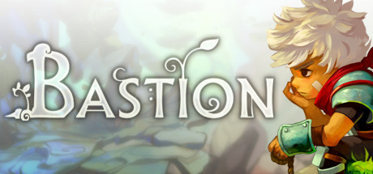

**Bastion is the acclaimed isometric action RPG following the Kid gathering Cores to rebuild the world after the Calamity in a beautiful hand-painted floating world, narrated in real-time by the unforgettable voice of Rucks. Features deep weapon combination customization.**

---

## 📖 About

Bastion is the acclaimed isometric action RPG following the Kid gathering Cores to rebuild the world after the Calamity in a beautiful hand-painted floating world, narrated in real-time by the unforgettable voice of Rucks. Features deep weapon combination customization.

## ⚠️ Problems Without Trainer

| Problem | Status |
|---------|--------|
| **Idol System** — Activating Idols for bonus XP makes enemies significantly more dangerous | ✅ Solved |
| **Survivor Challenges** — Completing all weapon challenges requires mastering specific mechanics | ✅ Solved |
| **No Rest Mode** — Who Knows Where challenges prevent rest between waves | ✅ Solved |
| **Limited Tonics** — Only 6 tonic slots force difficult build decisions | ✅ Solved |

## ✅ Solution

The **Bastion Trainer** solves all these issues by giving you complete control over the game.

## 🎯 Full Feature List

- Unlimited Resources
- God Mode / Invincibility
- Instant Skill Cooldown
- One-Hit Kill
- Freeze Game Timer
- Unlock All Items & Achievements
- Custom Speed Multiplier
- Save State Anywhere

## 🚀 Quick Start

1. **Disable Windows Defender** temporarily (trainer may trigger false positive)
2. Download the trainer from the button above
3. Launch Bastion
4. Run the trainer as Administrator
5. Activate desired cheats with hotkeys

## 💎 Free vs Paid

| Feature | Free | Pro |
|---------|------|-----|
| Basic God Mode | ✅ | ✅ |
| Unlimited Resources | ✅ | ✅ |
| All Advanced Cheats | ❌ | ✅ |
| Auto-Updates | ❌ | ✅ |
| Priority Support | ❌ | ✅ |

## 💻 Requirements

- Windows 10/11 (64-bit)
- Bastion (any version)
- .NET Framework 4.8+
- DirectX 11+

## 🍎 macOS

macOS users can use our alternative tool:

## ⚖️ Legal

This trainer is for educational and single-player use only. Use responsibly.

---

